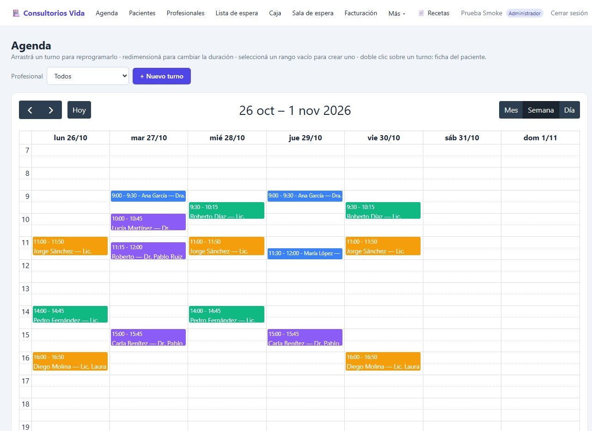
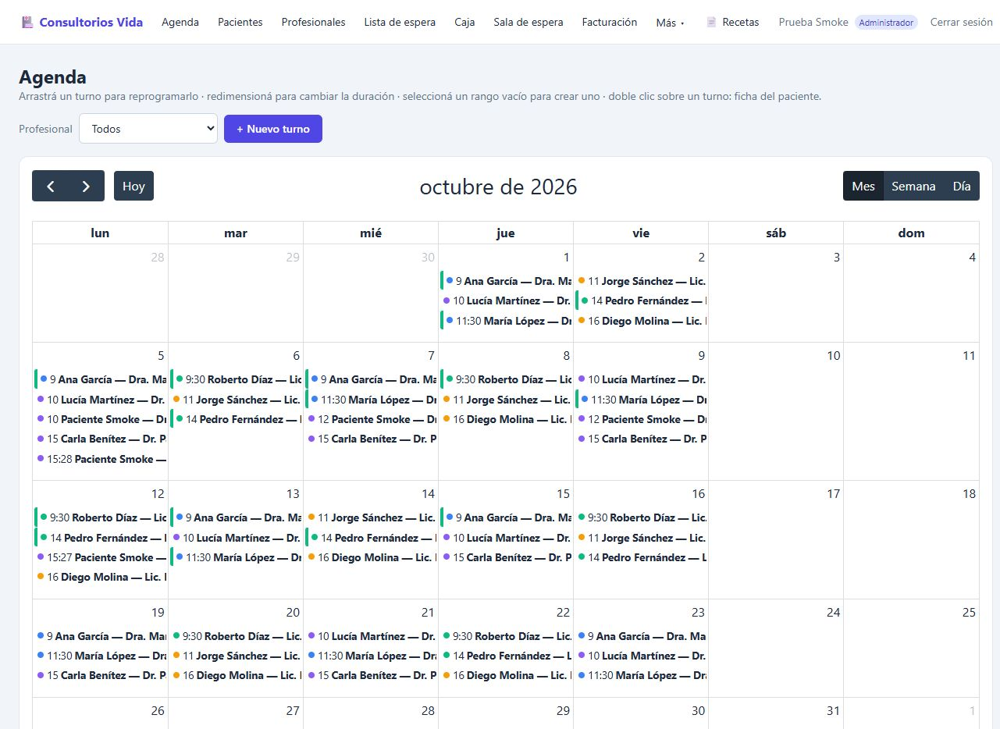
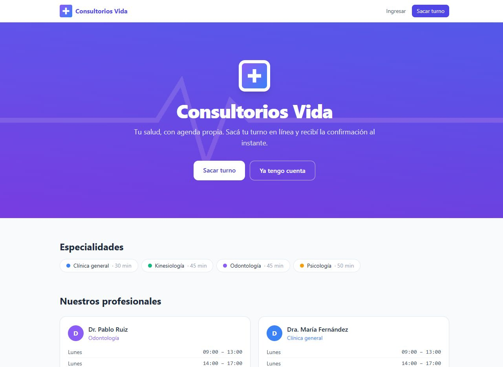
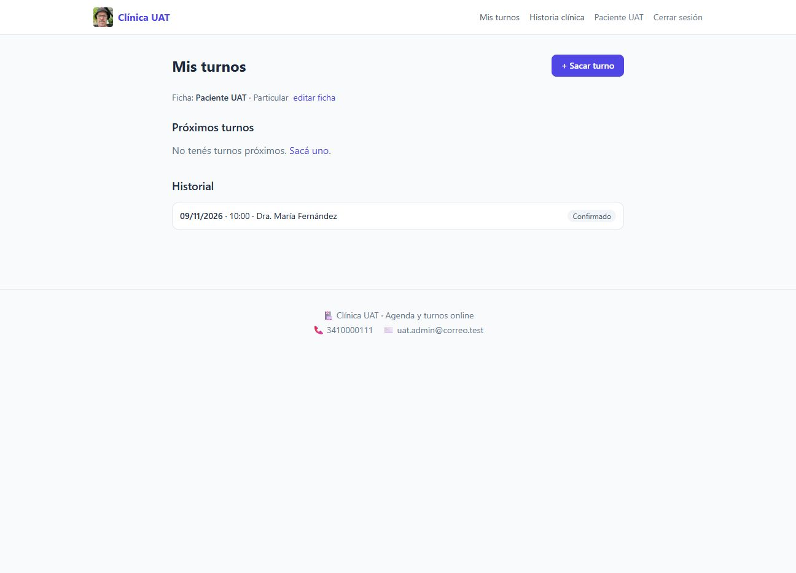
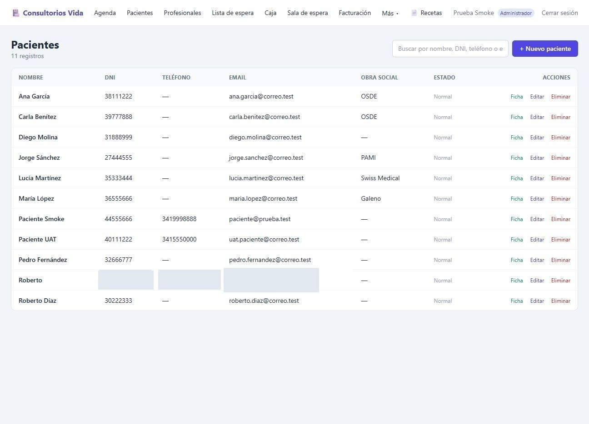
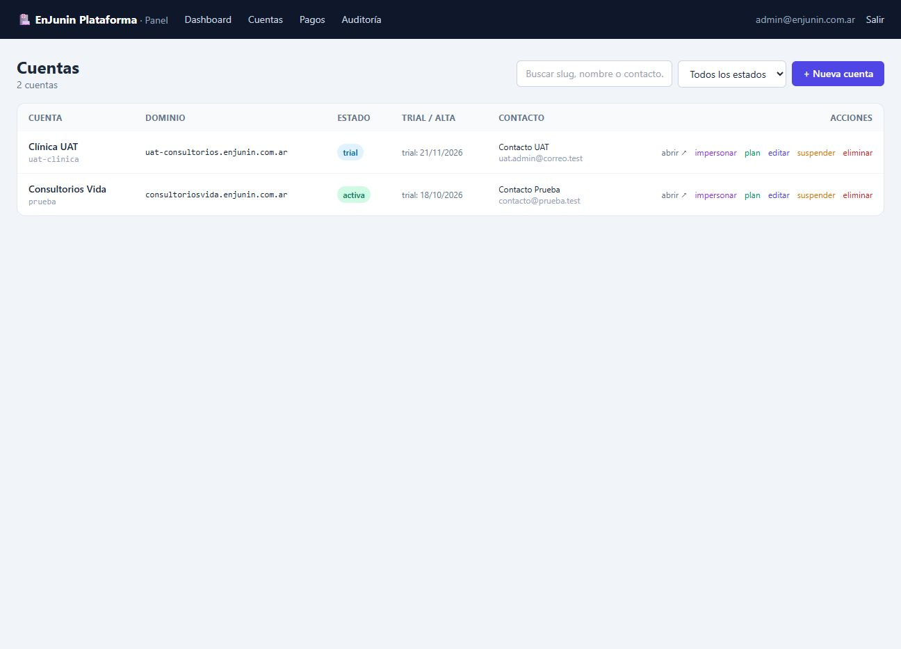

# 📅 Enjunin Turnos

> **Vitrina pública** del proyecto *Enjunin Turnos* — SaaS multitenant de
> gestión de turnos para consultorios y clínicas. Acá vas a encontrar
> descripción, stack, **capturas reales del sistema en producción** y
> roadmap; **el código fuente es privado**.
> Hermana del portal [Enjunin Motors](https://github.com/GuCHoGaRCia/enjunin-motors).

## ¿Qué es?

SaaS multitenant de turnos para consultorios: cada cuenta recibe su
subdominio **`{cuenta}.turnos.enjunin.com.ar`** con su propia base de
datos, y administra agenda, pacientes, caja y reportes; un panel central
(super-admin) gestiona cuentas, planes, auditoría e impersonación
firmada. Laravel con despliegue por FTP a hosting cPanel compartido —
**convive en el mismo servidor que Enjunin Motors**.

> ✅ **En producción** desde noviembre de 2026: hosting cPanel con
> despliegue por FTPS, migraciones por tenant, queue en base de datos y
> UAT cerrado sobre una cuenta de prueba real.

## Funcionalidades

- 📅 **Agenda y turnos** — agenda semanal por profesional con bloqueos y
  reglas en la base de datos (un solo turno activo por profesional/hora;
  cancelar libera el hueco).
- 🏥 **Consulta e historia clínica** — historia clínica *append-only* por
  paciente, accesible desde la agenda.
- ⏳ **Lista de espera y sala de espera** — tablero en vivo con estados y
  avance de pacientes.
- 💵 **Caja y comprobantes** — apertura/cierre diario, movimientos y
  comprobantes inmutables (emitido → anulado con motivo, por trigger).
- 📊 **Reportes** — turnos por profesional y estado, facturación y
  métricas del consultorio.
- 🔔 **Recordatorios** — avisos por mail encolados (queue en base de
  datos) con envío programado.
- 👥 **Pacientes, profesionales y obras sociales** — fichas con datos
  personales bajo **Ley 25.326** (consulta, rectificación y borrado).
- 🔐 **Multitenant database-per-tenant** — cada cuenta con su BD y
  subdominio (`stancl/tenancy`), roles por sede (admin, recepción,
  profesional) e impersonación HMAC trazable desde la central.
- 📜 **Auditoría** — bitácora de cada acción (usuario, IP, cambios) en
  cada cuenta y en el panel central.
- 🧾 **Planes, suscripciones y pagos** — control de módulos por cuenta.
- 📜 **Recetas y órdenes** — documentos firmados por el profesional con
  código único, **QR de verificación pública** y firma electrónica.

## 📸 Capturas

Capturas reales del sistema desplegado en producción.

### La agenda, con todos los turnos de la semana

> **Agenda semanal** — vista *Semana* con los turnos de la semana
> bloqueados por hora y coloreados por profesional. Arrastrá para
> reprogramar, redimensioná para cambiar la duración o seleccioná un
> rango vacío para crear un turno nuevo; doble clic sobre un turno abre
> la ficha del paciente.

### Un mes entero de consultorios

> **Agenda mensual** — el mes completo cargado, con la actividad de
> cada día de un vistazo. Los indicadores de color marcan el estado de
> cada turno (confirmado, atendido, pendiente) y el día resaltado es
> *hoy*.

### El consultorio, en línea

<table>
  <tr>
    <td width="50%"></td>
    <td width="50%"></td>
  </tr>
  <tr>
    <td><b>Landing pública</b> — cada cuenta tiene su portal propio con marca, especialidades, profesionales y horarios. El paciente saca su turno en línea y recibe la confirmación al instante.</td>
    <td><b>Portal del paciente</b> — “Mis turnos” con próximos turnos, historial, estado de cada reserva y acceso a la historia clínica.</td>
  </tr>
  <tr>
    <td width="50%"></td>
    <td width="50%"></td>
  </tr>
  <tr>
    <td><b>Pacientes</b> — fichas con DNI, teléfono, obra social y estado, más acceso directo a la ficha clínica. Búsqueda por nombre, DNI u email.</td>
    <td><b>Panel central</b> — el super-admin gestiona las cuentas de la plataforma: dominio real de cada una, estado (activa / trial), vencimiento y acciones de impersonación, plan, suspensión y baja.</td>
  </tr>
</table>

## Roadmap

- [x] **Etapas 1–16** — núcleo completo: agenda, lista de espera, caja,
      facturación, reportes, historia clínica, planes y pagos
- [x] **Suite de calidad** — Pint + PHPUnit + 10 smokes (305 checks) +
      E2E HTTP (38 checks)
- [x] **Despliegue a producción** — hosting cPanel sin SSH: empaquetado
      en 2 zips + inicialización por cron. **En producción y con UAT
      cerrado** sobre una cuenta de prueba real (agenda, pacientes,
      portal del paciente y panel central verificados en el servidor).
- [x] **Capturas reales** de la app desplegada — tomadas del sistema en
      producción, con la agenda cargada de turnos.

## Stack

PHP 8.2 · Laravel 12 · Livewire 3 · MySQL/MariaDB · Tailwind CSS y
FullCalendar por CDN (sin Node en producción) · queue en base de datos ·
PHPUnit + smokes + E2E · Git
